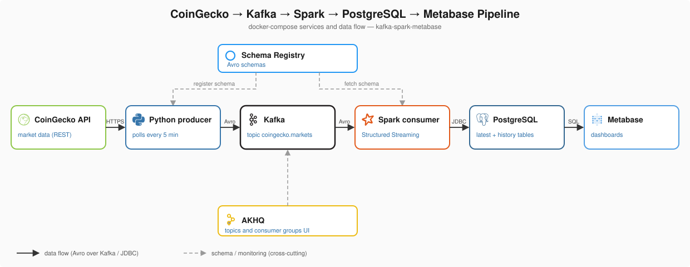

# Kafka Spark Metabase

Ingests market data from the **CoinGecko REST API** into **PostgreSQL**. A small Python producer polls the API, serializes each coin as **Avro**, and publishes it to **Kafka** (schemas live in **Schema Registry**). A **Spark Structured Streaming** job reads the topic, decodes the Avro records and writes them to Postgres over JDBC. **Metabase** reads those tables for dashboards. **AKHQ** provides a UI for topics and schemas.

## Architecture



Each micro-batch is written to `coingecko_markets_staging`, then merged into `coingecko_markets` (upsert) and `coingecko_markets_history` (insert) in one transaction, so a failed batch is rolled back as a whole.

| Component       | Role                                                          | Image / source                          |
|-----------------|---------------------------------------------------------------|-----------------------------------------|
| Producer        | Polls CoinGecko, publishes Avro records                       | [producer/](producer/)                  |
| Kafka           | Event streaming backbone (KRaft mode)                         | `confluentinc/cp-kafka:8.3.0`           |
| Schema Registry | Stores the Avro schema for topic values                       | `confluentinc/cp-schema-registry:8.3.0` |
| Consumer        | Spark job: streams the topic into Postgres (upsert + history) | [consumer/](consumer/)                  |
| PostgreSQL      | Destination database                                          | `postgres:18`                           |
| Metabase        | Dashboards on top of the Postgres tables                      | `metabase/metabase:v0.64.3.4`           |
| AKHQ            | Web UI for topics, schemas and consumer groups                | `tchiotludo/akhq:0.28.0`                |

## Prerequisites

- Docker and Docker Compose v2
- Optional: a free CoinGecko **Demo API key** (https://www.coingecko.com/en/api), recommended for reliable rate limits
- Ports `3000`, `5432`, `8080`, `8081`, `9092` free on the host

## Configuration

```sh
cp .env.example .env
```

Optionally set `COINGECKO_API_KEY` in `.env` (recommended for reliable rate limits). `.env` is git-ignored; never commit it.

| Variable                | Default                | Description                                                  |
|-------------------------|------------------------|--------------------------------------------------------------|
| `COINGECKO_API_KEY`     | — (optional)           | CoinGecko Demo key (`x-cg-demo-api-key` header); if empty, calls are unauthenticated with stricter rate limits |
| `COINGECKO_API_URL`     | — (required)           | CoinGecko markets endpoint (`.env.example` has the value)    |
| `POLL_INTERVAL_SECONDS` | — (required)           | Seconds between API calls                                    |
| `POSTGRES_USER`         | `postgres`             | Postgres user (also used by the consumer)                    |
| `POSTGRES_PASSWORD`     | `postgres`             | Postgres password (also used by the consumer)                |
| `POSTGRES_DB`           | `coingecko`            | Postgres database                                            |
| `POSTGRES_PORT`         | `5432`                 | Host port for Postgres                                       |
| `KAFKA_PORT`            | `9092`                 | Host port for Kafka                                          |
| `KAFKA_CLUSTER_ID`      | sample value           | KRaft cluster ID                                             |
| `SCHEMA_REGISTRY_PORT`  | `8081`                 | Host port for Schema Registry                                |
| `AKHQ_PORT`             | `8080`                 | Host port for AKHQ                                           |
| `METABASE_PORT`         | `3000`                 | Host port for Metabase                                       |

The Postgres credentials reach the Spark job as environment variables from `.env`, so no secrets are hardcoded in [consumer/](consumer/).

## Quick start

```sh
docker compose up -d --build
```

This starts Postgres, Kafka, Schema Registry, the producer, the consumer and AKHQ. The first build of `consumer` downloads the Kafka/Avro/JDBC jars into the image, so it takes a few minutes. The Spark job creates both tables if they do not exist.

```sh
docker compose ps
docker compose logs -f producer consumer
```

## Sink tables

One Spark job ([consumer/consumer.py](consumer/consumer.py)) writes every micro-batch (started as soon as new records appear in Kafka) to two tables in a single transaction:

| Table                       | Behaviour                                                                                  |
|-----------------------------|--------------------------------------------------------------------------------------------|
| `coingecko_markets`         | **Upsert**, PK = `id` → one row per coin, latest values (an older `last_updated` never overwrites a newer one) |
| `coingecko_markets_history` | **Insert**, PK = `id` + `last_updated` → one row per coin per CoinGecko update; duplicates are ignored (`ON CONFLICT DO NOTHING`), so a producer restart cannot stall the sink |

Each batch is written with Spark's JDBC writer to a staging table (`coingecko_markets_staging`), then merged into the two tables with SQL. Staging only holds the latest batch (it is overwritten every time, has no primary key and may contain duplicates); it exists because Spark's JDBC writer cannot upsert. Do not query it from dashboards.

> **Offsets:** the first run starts at the **earliest** offset, so every record already in the topic is loaded (this assumes the topic only holds records written with the current Avro schema; older ones cannot be decoded). Afterwards the job resumes from its checkpoint (volume `spark-checkpoint`). The job reads the latest schema from Schema Registry at startup; after changing the Avro schema, rebuild the producer and restart `consumer`.

## Verifying the pipeline

**1. Schema registered in Schema Registry**

```sh
curl -s http://localhost:8081/subjects
# ["coingecko.markets-value"]
curl -s http://localhost:8081/subjects/coingecko.markets-value/versions/latest
```

**2. Consumer status**

```sh
docker compose logs --tail 20 consumer   # look for "Batch N: wrote ... records"
```

If the job crashes, the container restarts and resumes from its checkpoint.

**3. Data in Postgres** (adjust user/database if you changed them in `.env`)

```sh
docker exec -it postgres psql -U postgres -d coingecko -c "SELECT count(*) FROM coingecko_markets;"
docker exec -it postgres psql -U postgres -d coingecko -c \
  "SELECT id, symbol, current_price, market_cap, last_updated FROM coingecko_markets ORDER BY market_cap DESC NULLS LAST LIMIT 10;"
```

Upsert mode: confirm there is one row per coin (expect no rows back):

```sh
docker exec -it postgres psql -U postgres -d coingecko -c \
  "SELECT id, count(*) FROM coingecko_markets GROUP BY id HAVING count(*) > 1;"
```

History table: rows accumulate per snapshot:

```sh
docker exec -it postgres psql -U postgres -d coingecko -c \
  "SELECT id, current_price, last_updated FROM coingecko_markets_history WHERE id = 'bitcoin' ORDER BY last_updated DESC LIMIT 10;"
```

**4. Raw Avro records:** open AKHQ at http://localhost:8080 and browse the `coingecko.markets` topic (decoded via Schema Registry), and the consumer groups.

## Dashboards (Metabase)

Open http://localhost:3000 and create the admin account on first launch. When asked to add your data, choose **PostgreSQL** and enter:

| Field    | Value                                        |
|----------|----------------------------------------------|
| Host     | `postgres`                                   |
| Port     | `5432`                                       |
| Database | `coingecko` (`POSTGRES_DB`)                  |
| Username | `postgres` (`POSTGRES_USER`)                 |
| Password | `postgres` (`POSTGRES_PASSWORD`)             |

Use `coingecko_markets` for the latest value per coin and `coingecko_markets_history` for trends. Metabase keeps its own settings and dashboards in an H2 file in the `metabase-data` volume, which is fine for local use; point it at a separate Postgres database (`MB_DB_*` variables) for anything shared.

## CoinGecko quota notes

- The free Demo plan allows roughly **30 calls/minute** and **10,000 calls/month**.
- One poll = one call (`per_page=250`, `page=1`). At the default 300s interval that is ~288 calls/day, ~8,640/month — under the monthly cap with some headroom. Lowering `POLL_INTERVAL_SECONDS` below ~260s would exceed 10,000 calls/month.
- **Failed requests and retries count toward the quota.** On HTTP 429, 5xx or a network error the producer retries up to 5 times with exponential backoff (5s, 10s, 20s, … capped at 120s, with jitter) and honours the `Retry-After` header. If all retries fail it skips the poll and waits for the next interval. Other 4xx errors (e.g. an invalid key) are logged and not retried.
- Restarting the producer (or `docker compose up`) triggers an immediate poll, so avoid restart loops.

## Data shape

The producer sends only flat fields, defined in [producer/coingecko_market.avsc](producer/coingecko_market.avsc): `id`, `symbol`, `name`, `currency` (e.g. `USD`), `current_price`, `market_cap`, `total_volume`, `market_cap_rank`, `fully_diluted_valuation`, `high_24h`, `low_24h`, `price_change_24h`, `price_change_percentage_24h`, `market_cap_change_24h`, `market_cap_change_percentage_24h`, `last_updated`. The Kafka key is the coin `id` (string). Numeric fields are `["null","double"]` with default `null`; nested fields such as `roi` are ignored. `last_updated` is a required string (ISO-8601) because the history table uses it in the primary key.

The Kafka topic is `coingecko.markets`, but the tables use explicit names, because a dot in a table name would be read by Postgres as `schema.table`.

## Repository layout

```
.
├── .env.example            # copy to .env; API key, polling interval, ports, credentials
├── docker-compose.yml      # all services
├── Dockerfile              # multi-stage on one `python:3.14-slim` base: `producer` and `consumer` images (compose picks one via build.target)
├── requirements.txt        # Python dependencies shared by producer and consumer
├── producer/               # Python producer: producer.py, Avro schema
├── consumer/               # Consumer: consumer.py (Spark Structured Streaming job, Kafka -> Postgres)
├── akhq/application.yml    # AKHQ cluster configuration
└── docs/architecture.svg   # architecture diagram shown in this README
```

## Stopping

```sh
docker compose down
```

Use `docker compose down -v` to also remove the Postgres data, the Kafka broker log, the Spark checkpoint and the Metabase settings, so the next run starts from scratch.
